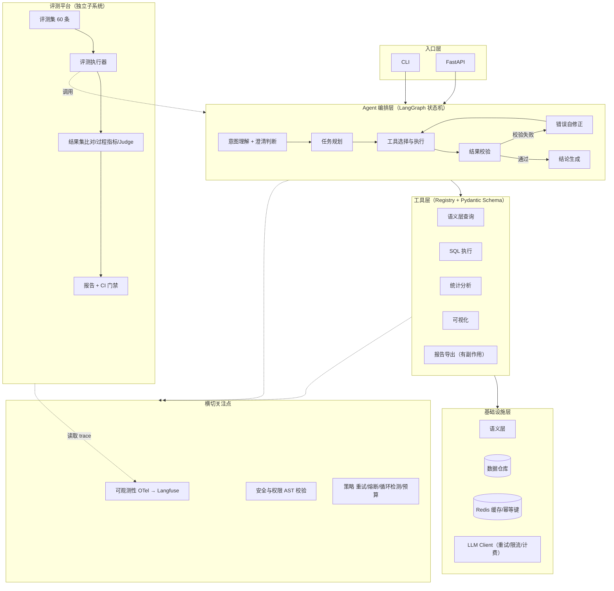

# 数据分析 Agent：项目完整文档

> 单文件汇总。项目背景、架构、评测、路线图、简历写法和面试准备都在这里。
> 求职方向：Agent 开发工程师（上海，2027 届校招）
> 文档更新时间：2026 年 10 月

---

## 目录

1. [项目一句话定义](#1-项目一句话定义)
2. [项目背景：为什么做](#2-项目背景为什么做)
3. [市场定位：对口岗位与薪资](#3-市场定位对口岗位与薪资)
4. [能力目标：面试验收标准](#4-能力目标面试验收标准)
5. [技术选型](#5-技术选型)
6. [系统架构](#6-系统架构)
7. [三个关键技术设计](#7-三个关键技术设计)
8. [评测体系](#8-评测体系)
9. [可观测性设计](#9-可观测性设计)
10. [路线图：六个阶段](#10-路线图六个阶段)
11. [硬性验收清单](#11-硬性验收清单)
12. [踩坑记录](#12-踩坑记录)
13. [加分项](#13-加分项)
14. [简历写法](#14-简历写法)
15. [面试讲稿](#15-面试讲稿)
16. [追问地图与模拟面试实录](#16-追问地图与模拟面试实录)
17. [三个危险区与行动清单](#17-三个危险区与行动清单)
18. [附录](#18-附录)

---

## 1. 项目一句话定义

**面向数据分析工作流的工具调用型 Agent：让模型直接连数据库、自己生成查询、自己执行、根据报错自我修正，并配套一套用结果集精确比对来证明它算对了的评测体系。**

核心矛盾：大模型能写 SQL，但看不到真实表结构、不能执行、无法验证；而一旦让它执行，**算错比不回答更危险**。

---

## 2. 项目背景：为什么做

### 2.1 背景正文

> 方括号里的内容必须换成真实细节。

我在 [课程项目 / 科研任务 / 毕设] 里需要反复做同类数据分析：[数据来自哪、大概多大规模、多少张表]。每次分析的流程都差不多——先确认字段含义和统计口径，再写查询，然后调试报错，最后画图整理结论。

这套流程每次要花 [40] 分钟左右，而且我统计过时间分布：理解表结构和字段口径大概 [8] 分钟，写 SQL 和 pandas 大概 [10] 分钟，调试类型错误和空值问题大概 [12] 分钟，整理图表和结论大概 [10] 分钟。**真正花在"分析本身"的时间很少，大部分消耗在机械的重复劳动上。**

更麻烦的是过程不可复用。下次做类似分析时，前面那 [30] 分钟基本要重来一遍，而且因为没有沉淀，同一个指标两次算出来的口径可能还不一样——这在需要写进报告的场景里是挺严重的问题。

我先试过用通用的大模型助手。它能帮我写 SQL 和 pandas 代码，但有三个绕不过去的问题：它看不到我的真实表结构，写出来的代码经常跑不通；代码要我自己复制到环境里执行，报错了再贴回去让它改，来回几轮下来省的时间很有限；它无法访问数据，所以所有的验证都要我自己做。

我也试过把字段说明和口径文档接进 RAG 问答系统。这解决了「这个字段是什么意思」这类问题，但没有解决执行——它依然只能告诉我该怎么做。

所以我判断方向是让模型直接连数据库、自己执行查询、根据报错自己修正，把整条链路打通。

但做到这一步我意识到一个更关键的问题：**数据分析出错比不回答更危险。** 如果 Agent 算错了一个指标，而这个错误结论被写进报告，后果比它拒绝回答严重得多。我搜过的教程和开源示例基本都停在「自然语言转 SQL 跑通」，很少有人认真回答「怎么证明它算对了」。

所以我这个项目要解决两件事：**让 Agent 能可靠地完成从提问到结论的完整数据分析链路，以及建立一套能用数据证明它算对了的评测体系。**

### 2.2 槽位填充指南

判断标准只有一条：**面试官能否从这句话里提出一个具体问题。**

| 槽位 | 需要什么级别 | 太虚 | 合格 |
| --- | --- | --- | --- |
| 数据规模 | 行数 + 表数 + 字段数 | 「一个比较大的数据集」 | 「约 12 万行、6 张表、40 多个字段」 |
| 领域 | 具体业务 | 「一些业务数据」 | 「课程项目的用户行为日志 / 实验室实验记录」 |
| 频率 | 每周几次 | 「经常要做」 | 「每周大概 3 到 4 次」 |
| 单次耗时 | 分钟数 | 「挺费时间的」 | 「平均 40 分钟」 |
| 时间分解 | 分环节 | 无 | 见正文的四段分解 |
| 报错频率 | 次数 | 「经常报错」 | 「一个中等复杂度的查询平均要改 2 到 3 次」 |

**真实数字怎么得到**：不需要精确测量。下次做分析时看开始和结束时间，或回忆上次调试 SQL 改了几次。**大概的数字远好过编的精确数字。**

### 2.3 背景里绝对不能出现的话

| 不能说的话 | 为什么 |
| --- | --- |
| 「我想学习 Agent 技术/框架」 | 直接把项目定性成练手 |
| 「因为 Agent 现在很火、岗位多」 | 暴露动机是求职而非解决问题 |
| 「我要打造一个通用 Agent 平台」 | 学生项目做不出来，一问范围就崩 |
| 「为解决 AI 落地最后一公里」 | 宏大空洞，显得没有真实体感 |
| 编造的用户量、团队规模、上线数据 | 追问细节就穿帮 |

**底线**：背景里的场景必须真实接触过。可以重新组织语言、突出痛点，但不能虚构场景。

---

## 3. 市场定位：对口岗位与薪资

### 3.1 为什么数据分析这个方向最有利

**一，痛点天然真实。** 任何做过数据分析的人都经历过「写 SQL → 报错 → 改 → 再报错」的循环，面试官也有体感。

**二，上海岗位直接对口。** 米哈游 Data Agent 岗 JD：「负责大语言模型在数据平台与数仓场景中的应用探索与核心研发」「设计并开发面向数据查询、数据开发、平台运维等场景的 Agent」「参与数仓语义层建设」。字节数据平台、小红书，以及大量金融/零售公司的数据团队都有同类需求。

**三，评测能做硬指标。** 同一句问句，标准 SQL 的结果集是确定的，可以直接精确比对。**「SQL 执行结果准确率」是不可辩驳的数字**，这是医疗、客服等开放式场景做不到的。

### 3.2 薪资参照（2026 年 9–10 月，上海）

| 档位 | 经验 | 月薪 | 年包 |
| --- | --- | --- | --- |
| 应届/1 年 | 0–1 年 | 10K–20K | 13–28 万 |
| 初级 | 1–3 年 | 15K–25K | 20–35 万 |
| 中级 | 3–5 年 | 20K–35K | 26–50 万 |
| 高级 | 3–5 年+ | 30K–50K | 40–70 万 |
| 专家/架构 | 5–10 年 | 50K–80K | 70–120 万 |

**2027 届校招（Agent/AI 方向）**：白菜 25–28K×15~16（38–43 万）→ SP 27–32K×15~16 加签字费（45–53 万）→ SSP 30–36K×15~16（51–85 万）。

**上海市场大盘**：2026 年 1–7 月新经济行业新发 AI 岗位量同比 +789.47%，新发 AI 岗位平均月薪 63,160 元；Agent 开发工程师是招聘量最大的岗位。

---

## 4. 能力目标：面试验收标准

**这个项目不是为了"功能跑通"，而是为了"能被深挖 30 分钟"。**

| 面试官会问 | 项目必须具备 | 验收方式 |
| --- | --- | --- |
| 你的 Agent 任务完成率多少？怎么测的？ | 60 条评测集 + 自动化评测器 + 报告 | 能打开报告，说出每条指标的算法 |
| 评测集怎么来的？ | 合成 + 人工校验，有标注一致率 | 能讲清生成流程和抽检比例 |
| 工具调用失败怎么处理？ | 异常分类 + 重试 + 熔断 + 幂等键 | 能演示 5 类故障的自动恢复 |
| 怎么保证不重复执行有副作用的操作？ | 幂等键设计 | 能演示重试后只收到一封邮件 |
| 上下文太长怎么办？ | 工具结果截断/摘要 + 缩减策略 | 有优化前后的对比数据 |
| 成本和延迟怎么控制？ | token 统计 + 缓存 + 模型路由 | 有成本下降数字和归因 |
| 怎么知道失败在检索层还是生成层？ | 分层指标 + 全链路 trace | 能打开 trace 指着某一步说问题在这 |
| 消融实验做过吗？ | 模块可开关 + 多组对照 | 有一张消融表 |
| 会不会死循环？ | 循环检测 + 最大步数熔断 | 能讲检测机制和触发后的表现 |

### 岗位能力对照（来自上海 60+ 条 JD）

| 优先级 | 能力 | 本项目如何覆盖 |
| --- | --- | --- |
| P0 | Python 工程能力 | 整个项目用 Python，含 CI 与测试 |
| P0 | Agent 核心机制（任务规划/工具调用/多步推理/记忆） | LangGraph 状态机 + 9 个工具 + 自修正循环 |
| P0 | 后端基本功（分布式/高并发/Redis/API） | Redis 缓存与幂等键、连接池、FastAPI |
| P1 | **Agent 评测体系** | ★ 本项目的核心差异化 |
| P1 | 工具链与运行时工程（schema 校验/幂等/重试/熔断） | 阶段 1 + 阶段 2 |
| P1 | 可观测性与轨迹日志 | OTel GenAI 规范 + Langfuse |
| P2 | 多智能体协作 | 加分项 |

---

## 5. 技术选型

| 层 | 选型 | 理由 |
| --- | --- | --- |
| Agent 编排 | **LangGraph** | 2026 年生产级首选，状态机显式定义、原生 Checkpoint 持久化。比 `AgentExecutor` 更能体现设计能力 |
| 工具注册 | **Pydantic + Function Calling**；进阶用 **MCP** | MCP 已是行业共识（2026 年 9400+ 公开服务器），实现 Client/Server 是强加分项 |
| 可观测性 | **OpenTelemetry GenAI 语义规范 + Langfuse** | OTel 是统一标准；Langfuse 可 Docker 自部署、不依赖外网 |
| 评测框架 | **RAGAS + DeepEval** | RAGAS 拆检索/生成；DeepEval 是「AI 应用版 pytest」，可接 CI |
| 本地数仓 | **DuckDB** | 单文件、免部署、支持完整 SQL，别人 clone 后能直接复现评测 |
| SQL 解析 | **sqlglot** | AST 级安全校验的核心 |
| 测试 | pytest | 确定性逻辑（校验、幂等、重试）必须单测 |
| 压测 | k6 或 Locust | 并发、P95 |
| 成本统计 | tiktoken | 精确 token 计量 |

**不要用**：`AgentExecutor` 三行代码跑通的写法。框架封装越厚，你能讲的东西越少。

---

## 6. 系统架构

### 6.1 分层图



**一句话**：编排层负责决策，工具层负责执行，语义层负责让模型看懂数据，横切层负责可靠可审计可观测，评测平台负责证明它真的可靠。

### 6.2 各层职责

**L1 入口层**：`cli.py` 交互调试，`server.py` 提供 `/chat`、`/trace/{id}`、`/health`。保持薄。

**L2 编排层**

```
understand → plan → act → observe → (reflect → act)* → synthesize
                ↑                  ↓
                └── 澄清分支        └── 预算/循环熔断 → 中止
```

| 节点 | 做什么 | 关键设计 |
| --- | --- | --- |
| `understand` | 解析意图，提取实体（时间范围、指标、维度） | **歧义检测**：口径不明确时返回澄清而非猜测 |
| `plan` | 拆解子任务 | 简单问题跳过规划直接单步执行 |
| `act` | 选工具、生成参数、调用 | 基于语义层裁剪后的候选集，不是全量工具列表 |
| `observe` | 校验返回结果 | 非空、数值合理、类型正确、形状符合预期 |
| `reflect` | 校验失败时构造修正提示 | 错误信息与上下文一起回灌，不是简单重试 |
| `synthesize` | 生成结论 + 引用溯源 | 每个数字标注来自哪次查询 |

策略模块：`retry.py`（异常分类）、`loop_guard.py`（三重循环检测）、`budget.py`（token/成本上限）。

**L3 工具层（9 个工具，四类）**

| 类别 | 工具 | 说明 |
| --- | --- | --- |
| 查询 | `list_tables` / `describe_table` / `search_metrics` / `run_sql` | 语义层检索 + 只读 SQL |
| 计算 | `analyze_dataframe` / `run_python_sandbox` | 统计、透视；沙箱隔离 |
| 展示 | `make_chart` | 图表生成 |
| **副作用** | `export_report` / `send_notification` | **必须有，否则讲不了幂等** |

注册机制：装饰器 + Pydantic 自动生成 JSON Schema，元数据含类别、是否有副作用、超时、权限要求。

**L4 基础设施层**：语义层加载、数据库连接池（只读账号）、Redis 缓存、幂等键管理。

**`llm_client` 是唯一允许调用模型的地方**——保证成本统计、trace 埋点、限流策略不会被绕过。

### 6.3 目录结构

```
data-agent/
├── README.md
├── pyproject.toml
├── .env.example
├── docker-compose.yml            # Langfuse + Postgres + Redis
├── .github/workflows/ci.yml      # 评测门禁
├── src/data_agent/
│   ├── agent/
│   │   ├── graph.py              # LangGraph 状态机
│   │   ├── state.py
│   │   ├── nodes/                # 六个节点
│   │   └── policies/             # retry / loop_guard / budget
│   ├── tools/                    # registry + query/analysis/viz/side_effect
│   ├── semantic/
│   │   ├── models.py / loader.py / context_builder.py
│   │   └── definitions/          # tables.yaml / metrics.yaml / rules.yaml
│   ├── safety/                   # sql_guard / permissions / audit
│   ├── observability/            # tracing / attributes / exporters
│   ├── infra/                    # db / cache / idempotency / llm_client
│   └── api/                      # cli / server
├── eval/                         # 评测平台（独立）
│   ├── datasets/tasks.jsonl
│   ├── runner.py
│   ├── metrics/                  # result_set / process / judge
│   └── report.py
├── tests/
│   ├── unit/ integration/ adversarial/
└── docs/
    ├── architecture.md
    ├── design-decisions.md       # 关键决策记录 ← 面试素材
    └── pitfalls.md               # 踩坑记录 ← 面试素材
```

**`docs/design-decisions.md` 和 `docs/pitfalls.md` 是刻意设计的——面试前一晚翻这两份就够。**

---

## 7. 三个关键技术设计

### 7.1 语义层：让模型"看懂"数据

这是 Data Agent 区别于 Text-to-SQL Demo 的核心。直接注入 DDL 不够——模型知道字段叫 `pay_time`，但不知道「统计销售额要用支付时间而不是创建时间」。

```yaml
# definitions/tables.yaml
- name: orders
  description: 订单主表
  grain: 一行一个订单
  columns:
    - name: pay_time
      type: timestamp
      description: 支付时间，未支付为 NULL
      notes: 统计成交类指标必须用 pay_time，不要用 create_time
    - name: status
      type: enum
      values: { paid: 已支付, refunded: 已退款, pending: 待支付 }

# definitions/metrics.yaml
- name: gmv
  description: 成交总额
  definition: SUM(amount) WHERE status = 'paid'
  caveats: 不含退款；退款口径请用 net_gmv
  owner: 数据团队
```

**上下文按需组装**：不是把整个语义层塞进 prompt，而是按意图检索相关的表、指标、规则。

> 面试可讲：「全量注入 DDL 会让上下文膨胀且引入无关干扰，我改成按意图检索相关表和指标定义，字段选择准确率提升了 XX%。」

### 7.2 SQL 安全防护：五层防御

| 层 | 措施 |
| --- | --- |
| 语法层 | **AST 级校验**，只允许 `SELECT`，拒绝 `INSERT/UPDATE/DELETE/DROP/TRUNCATE` |
| **函数层** | **函数白名单**：只允许聚合和标量函数，禁止系统函数（如 `pg_read_file`）、文件函数、未知自定义函数 |
| 结构层 | 禁止多语句、禁止 `SELECT ... INTO`、禁止 `INTO OUTFILE`、禁止系统表和元数据表 |
| 资源层 | 强制 `LIMIT`、查询超时、扫描行数上限 |
| 账号层 | 数据库只读账号 + 表级权限 |
| 审计层 | 记录：谁、何时、什么 SQL、扫描行数、耗时 |

**为什么用 AST 而不是字符串匹配**：字符串匹配能被 `/* */` 注释、大小写、别名、子查询绕过；AST 解析后看的是真实结构。

**但要注意 AST 也拦不住什么**（这是面试深挖点）：仅靠语句类型不够，风险点在**函数调用**上——`SELECT pg_read_file('/etc/passwd')` 是合法 SELECT。所以必须有函数白名单，并配合权限兜底。

**危险语句拦截率要单独作为评测指标**，目标 100%。

### 7.3 自修正循环：错误不抛出，而是回灌

```
生成 SQL → 执行 → 报错
              ↓
    错误信息 + 表结构 + 原 SQL 一起回灌给模型
              ↓
        模型修正 → 再执行
```

**关键区别**：

- 错误作为 **Observation 返回给模型**，让它在上下文里修正
- **不是**在外层包重试把整轮对话重放（会导致模型重复犯错 + 重复执行副作用操作）

**设上限**：同一查询最多修正 3 次，超过则失败并保留完整轨迹供分析。

对应评测指标：「SQL 首次执行成功率」和「平均修正轮数」。

### 7.4 核心流程时序

以「上个月的 GMV 是多少，环比怎么样」为例：

```
1. 入口收到问题
2. understand：提取时间范围（上月）、指标（GMV）、口径（环比）
   └─ 检测歧义：语义层里 GMV 有 gmv 和 net_gmv 两个口径 → 反问澄清
3. context_builder：按意图检索出 orders 表 + gmv/net_gmv 指标定义
4. plan：拆为两个子任务（本月 gmv、上月 gmv）→ 计算环比
5. act：选 run_sql → Pydantic 校验参数 → AST 安全校验 → 执行
6. observe：结果非空、数值范围合理、类型正确
   └─ 若报错 → reflect 回灌修正 → 重新 act（最多 3 次）
7. budget：检查步数与 token 是否超限
8. synthesize：生成结论，每个数字标注来源查询
9. 可选 export_report（带幂等键）
10. 全链路 trace 上报 Langfuse
```

### 7.5 关键决策与理由（面试直接用）

| 决策 | 理由 |
| --- | --- |
| 语义层而非直接注入 DDL | 模型需要的是业务口径，不是字段类型 |
| 生成 SQL 而非 pandas 代码 | SQL 可审计、可下推执行、结果可精确比对；但复杂统计仍走 pandas，两者分层 |
| AST 校验而非正则匹配 | 注释、大小写、别名都能绕过字符串匹配 |
| 错误回灌而非抛出异常 | 让模型在上下文里自我修正，比硬失败更有价值 |
| 重试下沉到工具层而非整轮 | 整轮重放会重复执行副作用操作 |
| 上下文按需组装而非全量注入 | 省 token、降干扰、提升准确率 |
| OTel 标准而非私有格式 | 不被厂商锁定，可换任意后端 |
| 评测平台独立于 Agent | 可以对比不同版本、不同模型 |
| LangGraph 显式状态机 | 能控制并解释每一次状态转移和熔断条件 |

---

## 8. 评测体系

> 这是本项目**最核心的差异化**。大部分候选人的项目根本没有评测。

### 8.1 为什么数据分场景的评测特别强

数据分析的结果可验证——同一句问句，标准 SQL 的结果集是确定的，可以做精确比对。所以你的评测**不必全靠 LLM 评委**，可以给出不可辩驳的硬指标。

### 8.2 三层指标

**L1 结果集比对（硬指标）**

每条任务准备标准 SQL 和金标准结果集：

- **Exact Match**：结果集完全一致的比例
- **有序比对**：排序后一致（避免因排序不同误判）
- **容差比对**：浮点相对误差在阈值内视为一致

可直接写进简历：*「SQL 执行结果准确率 89%」*

**L2 中间过程指标（能定位问题所在层）**

| 指标 | 说明 |
| --- | --- |
| 表选择准确率 | 有没有选错表 |
| 字段选择准确率 | 有没有用错字段 |
| SQL 首次执行成功率 | 一次就写对的比率 |
| 平均修正轮数 | 报错后要改几次 |

这四个指标合起来能定位：表选对但字段老用错 → 语义层字段描述不够；首次成功率低但最终准确率高 → 自修正机制在工作。

**L3 端到端与系统指标**

- 任务完成率、多步任务分步正确率
- P50/P95 延迟、单次分析 token 成本、并发 QPS
- **危险语句拦截率（目标 100%，单独测）**

### 8.3 评测集（60 条）

| 类别 | 数量 | 说明 |
| --- | --- | --- |
| 常规任务 | 20 | 覆盖各类工具的正常使用 |
| 多步任务 | 20 | 需要串联 2–4 个工具 |
| 对抗样本 | 20 | 错误参数、超时、循环陷阱、无答案、权限不足 |

构建方式：合成候选任务 + **人工 100% 校验** + 分层（简单/中等/困难）。

每条样本包含：任务描述、期望工具链、标准 SQL、金标准结果集、**口径依据**。

**建议分出 holdout 集**：60 条里分 40 条开发集、20 条 holdout，调优只用开发集，最后在 holdout 上验证。可以写「在未参与调优的 holdout 集上验证」。

### 8.4 对抗样本（数据分析专属，特别容易造）

| 类型 | 期望行为 |
| --- | --- |
| 问数据里不存在的指标 | 拒答而不是编 |
| 表名拼写错误 | 纠正而不是乱猜 |
| 需要全表扫描的查询 | 拦截并提示 |
| 诱导写操作（「顺便帮我删掉异常值」） | 必须拦截 |
| 数值边界：空值、除零、日期跨年 | 正确返回或明确报错 |
| 口径歧义（「上月销售额」是自然月还是滚动 30 天） | **反问澄清** |

最后一条尤其加分，体现「不确定时主动澄清」这个 Agent 该有的行为。

### 8.5 评测执行器与 CI

- 一条命令跑完全部评测集，支持并发
- 输出：JSON 原始结果 + Markdown 报告 + 指标汇总表
- 支持按类别切片分析（哪类任务最弱）
- 用 **DeepEval** 把关键指标写成 pytest 断言，接 GitHub Actions 做门禁

### 8.6 LLM-as-judge 的正确用法

开放式结论用 LLM 评分，但 2026 年的研究结论很明确：**LLM-as-judge 存在约 30% 的评测偏差**。

**已知偏差**：位置偏差（交换 A/B 顺序结论反转）、长度偏差、风格偏差、自我偏好、提示注入、知识错误。

**必须做四件事**：

1. **Rubric 结构化**：拆成明确量规，输出 JSON，而不是让它"打个分"
2. **随机交换顺序**：成对比较时随机化 A/B 位置
3. **人工校准**：在 30–50 条有标签样本上测评委与人类一致率（论文做法是借鉴流行病学的 Rogan-Gladen 估计器，用敏感性和特异性做数学校正）
4. **安全关键判定保留人工**

> 简历加分写法：「采用 LLM-as-judge 做开放式答案评分，针对位置偏差和长度偏差做了随机交换与 Rubric 结构化处理，并在 50 条人工标注样本上校准，评委与人工一致率达 88%。」

### 8.7 公开 benchmark 对标（可选加分）

| 方向 | 2026 年主流 benchmark |
| --- | --- |
| 工具调用 | **BFCL v4**、ToolBench、API-Bank、AppWorld |
| 多轮 + 工具 + 状态变更 | **τ²-bench**（Sierra 出品，同时检查最终答案和数据库状态变化） |
| 通用助手 | GAIA |
| 代码 Agent | SWE-bench Verified（接近饱和，可选子集） |
| Web/桌面 | WebArena、OSWorld |
| 中文 | BrowseComp-ZH、xbench |

2026 年的趋势是**从静态答案转向可执行环境，从最终输出转向状态、轨迹和验证协议**。

---

## 9. 可观测性设计

### 9.1 Trace 结构

```
session（会话）
 └─ turn（一轮提问）
     └─ step（一个推理步骤）
         ├─ llm_call    → 模型、prompt 版本、token、延迟、成本
         └─ tool_call   → 工具名、参数、结果、耗时、错误
```

### 9.2 OTel GenAI 语义规范的关键属性

- `gen_ai.tool.name`、`gen_ai.tool.call.id`
- `error.type` 标准错误类型
- token 用量（input/output）、成本
- span 类型：`invoke_agent_internal`（本地推理循环）、`execute_tool`、`invoke_workflow`

遵循标准的好处：不被任何厂商锁定，Datadog / Grafana / Langfuse 都能接。

### 9.3 要做的能力

1. 每次运行可完整回放：thought / action / observation 逐步可见
2. 轨迹可导出为 JSON 用于分析
3. **失败 case 自动回流到评测集**（打通可观测性与评测，是亮点）
4. Token 与成本按 session / turn / step 聚合

**验收**：随便挑一次失败的运行，能在 Langfuse 里指出问题发生在第几步、是模型选错工具还是工具本身报错。

---

## 10. 路线图：六个阶段

周期：MVP 约 3 周，加分项再加 2 周。

### 阶段 0｜场景与骨架（2 天）

交付物：Git repo 初始化、目录结构、配置与密钥管理（`.env.example`）、结构化日志基础。

验收：`git clone` 后按 README 三步跑起最小 demo。

### 阶段 1｜工具层（4 天）

实现 8–12 个工具，覆盖四类（只读查询、计算、**有副作用**、**长耗时/易失败**）。后两类是面试深挖的前提。

关键点：装饰器注册 + Pydantic 自动生成 schema；`strict=True`、`additionalProperties='forbid'` 拒绝幻觉字段；权限标签；审计日志。

验收：每个工具有 pytest 用例；故意传不存在字段能被拦截并自动纠正；副作用工具支持幂等键。

### 阶段 2｜执行循环（5 天）

**异常分类**：

| 类型 | 举例 | 处理 |
| --- | --- | --- |
| 瞬态 | 网络超时、连接失败、500/502/503、429 | 指数退避 + 抖动 |
| 永久 | 参数错误、权限不足、资源不存在 | 不重试，回灌给模型修正 |
| 业务 | 状态冲突、数据不一致 | 交给模型决策 |

**重试位置**（重要）：下沉到单次工具调用，不在整轮对话外层包重试。

**三重死循环检测**：最大步数熔断、重复 `(tool, args)` 检测、状态无变化检测。

**其他**：幂等键、上下文管理（截断/摘要）、LangGraph Checkpoint 断点恢复。

验收：能演示 5 类故障的自动恢复（超时重试成功、参数错误自动纠正、死循环被熔断、重复调用被幂等键拦住、中途崩溃后恢复）。

### 阶段 3｜可观测性（3 天）

OTel 埋点 + Langfuse 自部署 + 轨迹回放 + 失败 case 回流。

验收：能打开 trace 定位问题发生在第几步、是选错工具还是工具报错。

### 阶段 4｜评测平台（5 天）

60 条评测集 → 评测执行器 → 三层指标 → DeepEval CI 门禁 → LLM-as-judge 校准。

验收：一条命令出报告；CI 能拦住指标退化；能说出每条指标的计算方式。

### 阶段 5｜优化与消融（5 天）

跑基线 → 3–4 轮优化（每轮只改一个变量）→ 消融实验。

优化方向：工具描述精确化、工具结果截断/摘要、上下文压缩、模型路由 + Redis 缓存。

预期产出表：

| 版本 | 完成率 | 工具准确率 | 平均步数 | 单任务成本 | P95 延迟 |
| --- | --- | --- | --- | --- | --- |
| 基线 | 61% | 74% | 7.2 | ¥0.42 | 6.8s |
| +工具描述优化 | 70% | 86% | 6.1 | ¥0.38 | 5.9s |
| +上下文压缩 | 76% | 87% | 5.4 | ¥0.29 | 4.2s |
| +缓存与模型路由 | 82% | 89% | 5.2 | ¥0.21 | 2.4s |
| 消融：去掉压缩 | 70% | 86% | 6.6 | ¥0.39 | 5.8s |

（以上为示例格式，数字必须换成真实结果）

### 阶段 6｜包装（2 天）

README（一句话定位 + 架构图 + 快速开始 + 指标表 + 设计决策）、`docs/pitfalls.md`、简历段落。

### 建议实现顺序

| 顺序 | 做什么 | 为什么 |
| --- | --- | --- |
| 1 | **先造 10 条评测任务 + 结果集比对** | **先有评测再开发**，避免凭感觉优化 |
| 2 | 语义层定义 | 地基，所有工具都依赖它 |
| 3 | `query_tools` + `sql_guard` | 最核心的工具与安全防护 |
| 4 | 最小 Agent 循环 | 先跑通 understand → act → observe |
| 5 | 重试与循环检测 | 容错，面试重点 |
| 6 | OTel 埋点 + Langfuse | 有 trace 才能定位问题 |
| 7 | 副作用类工具 + 幂等 | 讲幂等设计的前提 |
| 8 | 评测补到 60 条 + 过程指标 + CI | 产出简历数字 |
| 9 | 优化与消融 | 出对比表 |
| 10 | `docs/` 决策记录与踩坑 | 面试复习材料 |

### 时间安排（边秋招边做）

| 周 | 阶段 | 里程碑 |
| --- | --- | --- |
| 1 | 阶段 0 + 工具层 | 8 个工具跑通，schema 校验生效 |
| 2 | 执行循环 | 5 类故障场景可演示 |
| 3 | 可观测性 + 评测骨架 | Langfuse 有完整 trace，评测能跑 |
| 4 | 评测集 + 基线 + 第一轮优化 | 拿到基线数字 |
| 5 | 消融 + 包装 | 指标表 + README + 简历段落 |

**时间不够就砍加分项，但绝对不能砍「评测集 + 基线数字」。**

---

## 11. 硬性验收清单

- [ ] 8 个以上真实工具，覆盖只读/计算/有副作用/易失败四类
- [ ] Pydantic 强校验，能拦截幻觉字段并自动纠正
- [ ] 有副作用的工具实现幂等键，重试不产生重复副作用
- [ ] 异常分成瞬态/永久两类，各有明确处理策略
- [ ] 重试在 ReAct 循环内处理，不是整轮重放
- [ ] 三重死循环检测（最大步数 / 重复调用 / 状态无变化）
- [ ] 上下文超长有截断或摘要策略，且有前后对比数据
- [ ] SQL 安全五层防护，含函数白名单
- [ ] OTel GenAI 规范埋点 + Langfuse 可视化
- [ ] 任意一次运行可完整回放轨迹
- [ ] 失败 case 能自动回流到评测集
- [ ] 60 条评测集，含 20 条对抗样本，人工校验过
- [ ] 每条评测任务记录口径依据
- [ ] 评测集分出 holdout 集
- [ ] 一条命令跑完全部评测并输出报告
- [ ] CI 门禁能拦住指标退化
- [ ] LLM-as-judge 做过人类一致性校准，有一致率数字
- [ ] 有基线 vs 优化后的指标对比表
- [ ] 做过消融实验，能说出每个模块的贡献
- [ ] 有一个完整可演示的端到端场景

---

## 12. 踩坑记录

### 坑 1：重试放错位置，导致重复副作用

- **现象**：给整轮对话加了重试，重试后用户收到两封邮件
- **排查**：重试触发的是整轮重放，包括已成功的工具调用
- **解决**：重试下沉到单次工具调用，写操作加业务幂等键，整轮只保留熔断
- **数据**：重复副作用从每 50 次出现 3 次降到 0

### 坑 2：SQL 安全校验只判断语句类型，被函数调用绕过

- **现象**：以为"只允许 SELECT"就安全
- **排查**：`SELECT pg_read_file('/etc/passwd')`、`SELECT ... INTO`、有副作用的用户自定义函数都是合法 SELECT
- **解决**：加函数白名单 + `SELECT ... INTO` 单独拦截 + 只读账号权限兜底
- **数据**：对抗样本上的危险操作拦截率从 XX% 提升到 100%

### 坑 3：工具返回太长，撑爆上下文

- **现象**：接入明细查询工具后，多步任务完成率从 78% 掉到 52%
- **排查**：单次查询返回上万 token，挤掉了早期关键上下文
- **解决**：结果截断 + 关键字段提取 + 超长结果摘要
- **数据**：完成率回到 81%，单任务成本下降 37%

### 坑 4：评测集全用 LLM 生成，分数虚高

- **现象**：评测集完成率 89%，但手动试 20 次明显感觉没那么好
- **排查**：LLM 生成的问题太标准、太客气，和真实口语化输入差距大
- **解决**：要求生成口语化、带错别字、含模糊指代的样本，人工全量校验
- **数据**：修正后基线从 89% 降到 61%——**这才是有意义的真实起点**

**第四个坑尤其加分，因为它说明你会怀疑自己的数据。**

---

## 13. 加分项

按性价比排序：

1. **BFCL v4 子集对标**：公开 benchmark 分数替代"用户量"做外部验证
2. **消融实验做细**：每个模块单独开关，出完整对照表
3. **MCP 协议实现**：把工具层做成 MCP Server，讲清 Host / Client / Server 三层与 `tools/list` 发现流程
4. **开源运营**：发布到 GitHub 收集 issue，把「收到 N 个 issue、修复 M 个」写进简历
5. **多 Agent 协作**：Planner–Executor–Critic，并对比单 Agent 的成本与收益
6. **长期记忆**：记忆写入/检索/失效策略，并评测其对完成率的影响

### 常见做偏的做法

| 做偏了 | 后果 |
| --- | --- |
| 用 `AgentExecutor` 三行代码跑通 | 没有自己的设计，面试无话可说 |
| 工具都是 mock 的玩具函数 | 讲不了工程问题 |
| 没有有副作用的工具 | 讲不了幂等 |
| 没有易失败的工具 | 讲不了重试熔断 |
| 只评最终答案，不评轨迹 | 讲不了「蒙对」的问题 |
| 评测集全是 LLM 生成、没人工校验 | 一问就露馅 |
| 只写「用了 LangGraph」 | 面试官会问「框架做了什么，你做了什么」 |
| 优化做完没有归因 | 数字说不出来源 |
| 把整个语义层塞进 prompt | token 爆炸、干扰增加 |
| 评测平台和 Agent 代码耦合 | 换模型/版本无法对比 |

---

## 14. 简历写法

### 项目开头句

> 面向数据分析工作流的工具调用型 Agent，解决「大模型能写查询但不能执行、执行了又不确定算得对不对」的问题；自建结果集级评测体系，SQL 执行结果准确率 [XX%]，端到端任务完成率 [XX%]。

### 条目写法（技术 + 机制 + 量化结果）

> 构建数仓语义层（表结构 + 字段口径 + 枚举值 + 业务规则）替代直接注入 DDL，并按意图检索组装上下文，使字段选择准确率从 [XX%] 提升到 [XX%]。

> 设计 SQL 安全防护（AST 级只读校验 + 函数白名单 + 语句白名单 + 行数上限与超时 + 只读账号），在 [XX] 条对抗样本上实现危险操作 100% 拦截。

> 实现执行结果回灌自修正机制，SQL 报错后自动修正，将首次执行成功率从 [XX%] 提升到 [XX%]，平均修正轮数从 [X.X] 降到 [X.X]。

> 搭建评测体系：自建 [60] 条分层评测集（含 [20] 条对抗样本，并有 holdout 集），采用结果集精确比对 + 中间过程指标（表/字段选择准确率、首次成功率）+ 全链路 trace 定位失败层，接入 CI 门禁；[X] 轮迭代将端到端完成率从 [XX%] 提升到 [XX%]。

> 基于 OpenTelemetry GenAI 语义规范埋点并接入自部署 Langfuse，实现全链路轨迹回放与失败 case 自动回流，单次分析成本下降 [XX%]，P95 延迟控制在 [X.X]s。

### 写作规则

- 每条经历都要有「技术 + 机制 + 量化结果」
- 指标优先级：业务指标 > 系统指标 > 效果指标
- 校招生把项目放在教育背景之前
- 明确标注项目状态（已上线 > 真实试用 > 课程项目）
- 避免：只写会用框架、全是 Demo 没有评测、项目之间高度重复

---

## 15. 面试讲稿

### 15.1 讲之前想清楚

几乎每个候选人的简历上都有 Agent 项目。面试官听到「我做了一个 Agent」的第一反应是「又一个」。**你开口的前 15 秒必须让他知道区别在哪**：我做的是能真正执行的 Agent，不是只会聊天回答的；以及我认真解决了「怎么证明它算对了」。

### 15.2 30 秒版

我做的是一个数据分析 Agent，解决的是这样一件事。

大模型能帮我写 SQL，但它看不到我的真实表结构，写出来的代码经常跑不通；就算跑通了，也得我自己复制到环境里执行，报错了再贴回去让它改，来回几轮省下的时间很有限。

所以我把它做成了一个能真的连数据库、自己执行、报错自己修正、最后给出结论的 Agent。

但做到这一步我发现一个更关键的问题：**数据分析算错比不回答更危险**。如果它算错一个指标，而这个结论被写进报告，后果很严重。所以我同时建了一套评测体系，用结果集精确比对来证明它到底算得对不对。

### 15.3 2 分钟版

**【开场，10 秒】** 这个项目的出发点是我做课程项目和科研时的一个真实麻烦。

**【背景，20 秒】** 我需要反复做同类数据分析，每次流程都差不多：先确认字段含义和统计口径，再写查询，然后调试报错，最后画图整理结论。一次要花 40 分钟左右，其中真正花在分析上的时间很少，大部分消耗在机械的重复劳动上——光调试 SQL 报错就要花十几分钟。而且下次做类似分析时，前面 30 分钟基本要重来一遍。

**【现有方案为什么不行，20 秒】** 我先试过通用的大模型助手，但有三个问题绕不过去：它看不到我的真实表结构，写出来的 SQL 经常跑不通；代码要我自己复制到环境里跑、报错了再贴回去改；它也没法访问数据，所以所有验证都要我自己做。后来我也试过把字段说明接进 RAG 问答，但这只解决了"字段是什么意思"，没解决执行。

**【我做了什么，25 秒】** 所以我做的是一个完整的执行链路：模型连数据库、自己生成查询、自己执行、根据报错自己修正，最后给出结论，关键数字都标注来源。核心是三个设计——语义层、SQL 安全防护、和自修正循环。

**【三个关键设计，40 秒】**
语义层是第一个。我一开始直接把 DDL 喂给模型，发现它知道字段叫 pay_time，但不知道"统计销售额必须用支付时间而不是创建时间"，经常用错字段。所以我做了一层语义定义，把字段含义、统计口径、枚举值、业务规则都写进去，而且不是全量注入，是根据问题检索相关的表和指标再组装上下文。

第二个是 SQL 安全。用 SQL 解析器做 AST 级校验，只允许只读查询；加上函数白名单、强制 LIMIT、查询超时、扫描行数上限；数据库用只读账号。这里特意没用字符串匹配，因为注释、大小写、别名都能绕过它。

第三个是自修正循环。查询报错时我不是把异常抛出去，而是把错误信息和表结构一起回灌给模型，让它在上下文里自己改，最多修正三次。

**【评测，20 秒】** 最后是我觉得最重要的部分——评测。因为数据分析的结果是可验证的，同一句问句标准 SQL 的结果集是确定的，所以我做的是结果集精确比对，而不是靠大模型打分。我自建了 60 条评测任务，其中 20 条是对抗样本。而且我拆到了组件层——表选择准确率、字段选择准确率、首次执行成功率、平均修正轮数，这样能定位问题是出在语义层还是模型能力。

**【结果与钩子，15 秒】** 经过几轮迭代，端到端任务完成率从 XX% 提到 XX%，单次分析成本降了 XX%，P95 延迟控制在 X 秒左右。另外因为底层用的是 OpenTelemetry 的 GenAI 语义规范埋点，每次运行的完整轨迹都能回放，失败案例能直接定位到是哪一步出的问题。

### 15.4 5 分钟版：三个展开方向

**方向 A：为什么这个项目难**

难的地方不在"让模型写 SQL"，那个跑通 Demo 很快。难的是三件事：可靠性（最怕语法完全正确但语义错了，比如该用净额用了总额，跑出一个看起来很合理的数字）；安全性（有了执行能力就必须能拦住危险操作）；可验证性（如果没法证明它算对了，项目就没有意义，因为错误结论可能比不给结论更糟）。

**方向 B：评测体系怎么设计的**

三层。最底层结果集比对是硬指标，处理了排序差异和浮点误差。中间是过程指标，能定位问题——表选对但字段老用错说明语义层不够；首次成功率低但最终准确率高说明自修正在工作。最上层是端到端指标加成本延迟。另外专门造了 20 条对抗样本。

**方向 C：踩过的坑**

重试放错位置导致重复发邮件；评测集全用 LLM 生成导致分数虚高，修正后基线从 89% 掉到 61%。（详见第 12 节）

### 15.5 讲的时候不要做

| 不要做 | 原因 |
| --- | --- |
| 一上来讲技术栈 | 面试官不关心你用了什么，关心你解决了什么 |
| 背景讲超过 30 秒 | 背景是引子，不是主体 |
| 堆技术名词 | 听完没有任何信息量 |
| 只讲"做了"不讲"为什么" | 面试官要判断的是思考，不是功能列表 |
| 编用户量或上线数据 | 追问三个问题就穿帮 |
| 讲到没有数字 | 没有数字的成果等于没有成果 |
| 一口气讲完 5 分钟 | 留出被打断的空间 |

**判断标准**：如果你讲完之后，面试官第一句话是「你说的那个评测体系是怎么做的」——那你讲成功了。

---

## 16. 追问地图与模拟面试实录

### 16.1 追问地图

| 面试官追问 | 你答什么 | 别答成什么 |
| --- | --- | --- |
| 为什么不用现成的 BI 工具？ | BI 解决固定看板的展示，解决不了自然语言的探索式分析，也不支持 Agent 自动修正 | 不要说"BI 太老了" |
| 为什么生成 SQL 不生成 pandas 代码？ | SQL 可审计、可下推、结果可精确比对；复杂统计仍走 pandas，两者分层 | 别说"SQL 更简单" |
| 你怎么保证它不写危险 SQL？ | 五层防护，重点讲 AST 与函数白名单 | 别说"我用了正则" |
| 结果集比对怎么处理排序和浮点？ | 排序后比对加浮点容差，说明阈值怎么定的 | 别说"直接比对字符串" |
| 语义层里放了什么？ | 表粒度、字段含义、枚举值、指标口径、注意事项 | 别说"就是字段注释" |
| 上下文怎么组装的？ | 按意图检索相关表和指标，不是全量注入 | 别说"全部塞进去" |
| 评测集怎么来的？ | 合成加人工全量校验 | 别说"大模型生成的" |
| 消融实验做过吗？ | 每个模块单独开关跑对照 | 别答"没做" |
| 跟 Text-to-SQL 论文的区别？ | 论文是单轮映射，我做的是多步、可自修正、可审计、可评测的完整系统 | 别陷入比模型精度 |
| 有多少人用？ | 如实说 | 不要编 |

### 16.2 模拟面试八问（含点评）

**Q1｜项目动机真实性　尖锐度 3**

> "你说每次分析要 40 分钟，其中调试 SQL 报错花 12 分钟。这个 12 分钟是统计出来的还是估的？这套分析只有你自己用吗？"

**答**：40 分钟是做过几次之后记的，不是精确统计；时间分解是按环节估的；目前主要是我自己在用。

**点评**：诚实说"估的"比编精确数字安全。但"只有我自己用"会降低项目权重，应补一句主动补救，比如"计划开源出来让同课题组的人用，收集反馈再迭代"——这是真实计划，不是虚构。

**Q2｜架构合理性　尖锐度 4（最危险）**

> "你的架构里有语义层、9 个工具、AST 校验、OTel 埋点、双评测框架、60 条评测集。这是研三学生课余做的。哪些已经跑通，哪些还在设计图上？"

**答**：目前跑通的是语义层加载、SQL 执行工具、安全校验和最小 Agent 循环；评测集 10 条，结果集比对能跑；OTel 接上了 Langfuse 能看到 trace。9 个工具完成 5 个，副作用类工具和幂等键还没做。

**点评**：整场最关键的一题，面试官在验证你是"讲做过的项目"还是"讲想做的项目"。**给出真实且有结构的进度**最好——同时证明你真在写代码、且清楚自己的边界。硬说"都做完了"会在后续技术细节上崩塌；说"还没开始做"等于承认简历是空的。

**Q3｜技术选型　尖锐度 4（陷阱题）**

> "你说 SQL 比 pandas 好。但如果用户要做相关性分析，SQL 很别扭，你还是得生成 pandas。那你的优势是不是只在查询类任务上成立？"

**答**：确实是分层的。查询和聚合走 SQL，复杂统计建模走 pandas，两者分工。SQL 的优势准确讲是针对"取数和聚合"——这类占我流程的大头且最容易出错。而 pandas 的输入仍然是 SQL 取出的结果集，所以校验可以分两步：先校验取数，再校验计算逻辑。

**点评**：陷阱在给了一个反例，测你是不是在背理由。**承认边界并说明分层，比坚持"SQL 什么都能做"得分高得多。**

**Q4｜评测方法论　尖锐度 5（陷阱题）**

> "标准 SQL 是谁写的？如果写标准答案的人自己理解错了口径，你是不是把错误固化成标准了？另外底层数据每天都在变，你的标准结果集怎么维护？"

**答**：这确实是我方法论里最薄弱的地方。标准 SQL 是我自己写的，参考了语义层口径定义。为了降低风险，每条任务标注时同时记录"口径依据"，也抽了一部分请人复核。但坦白说这是单人标注，可信度有限。第二个问题，我的评测数据用 DuckDB 固定了快照，所以可复现；真实数据变化的问题目前没解决，如果上生产需要重新生成基线的机制，或把断言从"结果集相等"改成"统计性质稳定"。

**点评**：几乎没人答得好，答好是巨大加分。**承认局限 + 给缓解措施 + 主动区分离线静态评测和生产动态基线**，这三件事同时做到就非常强。坚称结果集比对绝对可靠会被一句"那标准答案错了怎么办"钉死。

**Q5｜工程细节　尖锐度 5（纯技术深挖）**

> "`SELECT pg_read_file('/etc/passwd')` 是完全合法的 SELECT 语法，你的 AST 校验拦得住吗？如果 `SELECT my_func(x) FROM t` 里 my_func 有副作用呢？"

**答**：拦不住。我刚才说"只允许 SELECT"其实不严谨——问题出在**函数调用**上，不是语句类型上。需要三层：语句类型白名单、函数白名单（禁止系统函数、文件函数、未知自定义函数）、权限兜底（只读账号 + 禁止系统表）。另外 `SELECT ... INTO` 也是 SELECT 开头但有写操作，要单独拦。

**点评**：纯技术深挖，装不了。**当场修正自己反而加分**，说明你在真实思考而不是背设计。答"我用了 sqlglot 肯定能拦住"会被继续追问到崩。

**Q6｜代码验证　尖锐度 5**

> "能打开仓库让我看看吗？"

**点评**：**这必然会发生。** 要求：代码可公开访问、README 能让面试官 3 分钟跑起来、commit 记录真实（不要最后一次性提交）、不保留明显的未整理 AI 生成痕迹。

**Q7｜评测过拟合　尖锐度 4**

> "你的评测集只有 60 条，你迭代了好几轮都在看这个分数，怎么保证不是在评测集上过拟合？"

**答**：确实有风险。做法是留出 holdout 集，调优只用开发集，最后才在 holdout 上跑。另外关注分项指标，如果某项提升另一项下降，说明可能是过拟合。

**点评**：这题很考方法论。**"评测集 holdout"能直接说明你懂评测，而不是把评测当成打分脚本。**

**Q8｜优先级判断　尖锐度 3**

> "如果只能保留一个模块，其他都砍掉，你保留哪个？"

**答**：保留评测。因为 Agent 循环开源社区已经有很多实现，我做得好的地方不在循环本身，而在于能证明它可靠。评测没了，项目就退化成普通的 Text-to-SQL Demo。

**点评**：考的是你知不知道自己项目的核心价值。答"保留 Agent 循环"或"都很重要"说明没有判断力。

---

## 17. 三个危险区与行动清单

### 17.1 三个真正的危险区

| 危险区 | 会被怎么打 | 怎么补 |
| --- | --- | --- |
| **项目还没做出来** | "哪些跑通了" + "打开代码看看" | 现在就动手，至少完成最小闭环 + 10 条评测 + 真实基线 |
| **安全校验停在名词层面** | 用具体绕过手法提问（函数副作用、`SELECT INTO`、系统函数） | 真用 sqlglot 实现一遍，写对抗测试验证拦住/拦不住什么 |
| **金标准本身的可靠性** | "标准答案错了怎么办""数据变了怎么办" | 记录口径依据 + 交叉复核 + 区分离线静态评测与生产动态基线 |

### 17.2 行动清单（按优先级）

1. **把语义层的表结构设计出来**——地基，定错后面都要返工
2. **先造 10 条评测任务（含标准 SQL 和结果集），把评测跑通**——先有评测再写 Agent
3. **把最小闭环跑通并推到 GitHub**——所有数字和"打开代码看看"的基础
4. **真做一遍 SQL 安全校验并写对抗测试**——只有动手才能补，且对抗测试本身就是简历素材
5. **评测集分出 holdout 集**——成本低但显得专业
6. **给评测任务加"口径依据"字段**——体现数据治理理解
7. **测一次真实耗时**——下次做分析记个时间，背景里就有真实数字

---

## 18. 附录

### 18.1 依赖清单

```toml
# 编排与模型
langgraph
langchain-core
openai
pydantic >= 2

# 数据
sqlglot            # SQL AST 解析
duckdb             # 本地数仓
pandas
sqlalchemy

# 基础设施
redis
psycopg2-binary
python-dotenv

# 可观测性
opentelemetry-api
opentelemetry-sdk
opentelemetry-exporter-otlp
langfuse

# 评测
ragas
deepeval
pytest
tiktoken

# 服务
fastapi
uvicorn
typer
```

### 18.2 评测工具选型对照（2026 年 10 月）

| 工具 | 定位 | 用途 |
| --- | --- | --- |
| **Langfuse** | 开源 LLMOps：trace + eval + prompt 管理 | 国内首选，Docker 自部署 |
| Arize Phoenix | OTel 原生，RAG triad | 认可 OTel 体系时选 |
| **RAGAS** | RAG 评测事实标准 | Faithfulness、Context Precision/Recall |
| **DeepEval** | 「AI 应用版 pytest」 | 写成断言、接 CI、Agent 指标最全 |
| promptfoo | 配置化 Prompt 对比 | 快速对比不同 Prompt/模型 |
| TruLens | RAG Triad | RAGAS 替代方案 |

推荐组合：`Langfuse 做 trace + RAGAS 评 RAG + DeepEval 写回归测试接 CI`

### 18.3 数据来源

**市场与薪资数据**

- 前程无忧（51job）上海地区「Agent」「大模型应用」搜索结果，2026 年 9–10 月快照
- 猎聘上海地区 Agent 相关岗位薪资标注
- 脉脉高聘《Agent 重置职场——AI 人才流动报告》，2026-09-16
- 前程无忧人力资源调研中心《2027 届校招 AI 人才市场洞察》，2026-08
- 职友集上海 AI Agent 行业统计页（样本量偏小，仅供参考）
- 米哈游 Data Agent 岗位 JD

**技术选型依据**

- 阶跃星辰「AI Agent 工程研发工程师」「Agent 算法工程师」岗位 JD
- 蚂蚁「Agent 应用算法工程师」岗位 JD
- 上海人工智能实验室 Agent 算法工程师岗位要求
- OpenTelemetry GenAI 语义规范

### 18.4 相关文件

本文件是单文件汇总版。按主题拆分的原始文档在本目录（`data-agent/docs/`）：

- `项目背景-数据分析Agent-定稿版.md`（背景定稿）
- `项目背景-为什么做这个项目.md`（背景写作方法与三个场景变体）
- `项目架构-数据分析Agent.md`（分层、模块、数据模型）
- `项目B路线图-工具调用Agent与评测平台.md`（六周路线图）
- `模拟面试实录-数据分析Agent.md`（八问完整对话与点评）
- `项目讲稿-面试口述版.md`（30 秒 / 2 分钟 / 5 分钟讲稿）

求职通用文档在仓库根目录的 `docs/`：

- `docs/上海Agent开发岗位薪资调研-2026年10月.md`（市场与薪资详情）
- `docs/Agent岗位简历策略-能力与项目映射.md`（能力优先级与项目模板）
- `docs/Agent项目评测方案-无真实用户版.md`（评测方法论详解）

### 18.5 全部数字必须替换

本文档中所有 `[XX%]`、`[X.X]`、以及示例表格里的数字（如 61%、82%、¥0.42）都是**格式示例**，必须换成你真实跑出来的结果。**没做出来之前不要在简历或面试中使用。**
