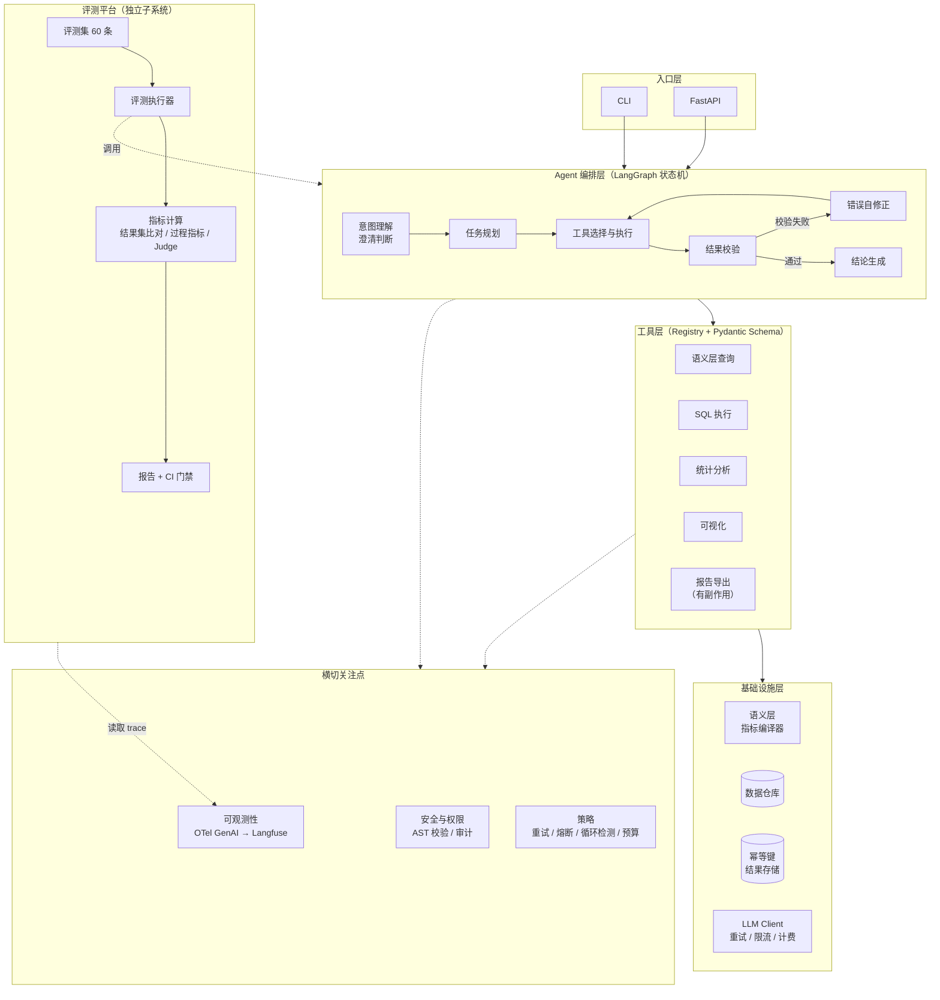

# 项目架构：数据分析 Agent

> **实现状态**：本方案已实现并跑通真实模型评测，代码在 `data-agent/`，
> 实测数据与踩坑记录见那里的 `README.md`。
> 与本文档有三处差异（都在代码里做了取舍并注明原因）：
> 1. 规划节点折进了 `understand`，省一次模型调用
> 2. 结果存储从纯内存改成可落盘，服务化后多 worker 必须共享
> 3. 服务编排拆出 `service/`，`api/` 只放接口定义
> 4. 指标定义从"手写 SQL 片段 + 手写 join"演进成**声明式定义 + 编译器**：
>    表关系单独声明，join、归期过滤、粒度对齐由 `semantic/compiler.py` 推导。
>    这一步是对齐行业做法（dbt metrics / Cube / LookML）之后的改造，详见 README
>    的「语义层与指标编译」一节

---

## 一、整体分层



**一句话解释这个架构**：Agent 编排层负责决策，工具层负责执行，语义层负责让模型"看懂数据"，横切层负责让整个过程可靠、可审计、可观测，评测平台负责证明它真的可靠。

---

## 二、各层职责

### L1 入口层

| 模块 | 职责 |
| --- | --- |
| `cli.py` | 交互式对话，流式输出，开发调试用 |
| `server.py` | FastAPI，提供 `/chat`、`/trace/{id}`、`/health` |

保持薄，不放业务逻辑。

### L2 Agent 编排层 —— 项目的大脑

用 **LangGraph** 定义显式状态机，而不是让框架黑盒跑循环。这样你能控制每一次状态转移，也能讲清楚"我自己设计了哪些熔断条件"。

**状态流转**

```
understand → plan → act → observe → (reflect → act)* → synthesize
                ↑                  ↓
                └── 澄清分支        └── 预算/循环熔断 → 中止
```

| 节点 | 做什么 | 关键设计 |
| --- | --- | --- |
| `understand` | 解析意图，提取实体（时间范围、指标、维度） | **歧义检测**：口径不明确时返回澄清而非猜测 |
| `plan` | 拆解为子任务列表 | 简单问题跳过规划，直接单步执行 |
| `act` | 选择工具、生成参数、调用 | 工具选择基于语义层裁剪后的候选集，不是全量工具列表 |
| `observe` | 校验工具返回结果 | 结果集非空、数值合理、类型正确、与预期形状一致 |
| `reflect` | 校验失败时构造修正提示 | 把错误信息和上下文一起回灌，不是简单重试 |
| `synthesize` | 生成结论 + 引用溯源 | 每个数字标注来自哪次查询 |

**策略模块**（`agent/policies/`）

| 模块 | 职责 |
| --- | --- |
| `retry.py` | 异常分类：瞬态（指数退避 + 抖动）/ 永久（不重试）/ 业务（交给模型） |
| `loop_guard.py` | 三重检测：最大步数、重复 `(tool, args)`、状态无变化 |
| `budget.py` | 单次任务的 token 与成本上限，超限中止 |

### L3 工具层 —— 项目的核心资产

**注册机制**

```python
@tool(
    name="run_sql",
    description="执行只读 SQL 查询并返回结果集",
    category="query",          # query / analysis / viz / side_effect
    side_effect=False,
    timeout=30,
)
def run_sql(sql: SqlInput) -> SqlOutput: ...
```

从 Pydantic 模型自动生成 JSON Schema，避免手写出错。每个工具带元数据：类别、是否有副作用、超时、权限要求。

**工具清单（9 个，覆盖四类）**

| 类别 | 工具 | 说明 |
| --- | --- | --- |
| 查询类 | `list_tables` | 列出可用表 |
| | `describe_table` | 查表结构与字段口径 |
| | `search_metrics` | 按关键词检索指标定义 |
| | `run_sql` | 执行只读 SQL |
| 计算类 | `analyze_dataframe` | 对中间结果做统计、分组、透视 |
| | `run_python_sandbox` | 隔离环境下执行分析代码 |
| 展示类 | `make_chart` | 生成图表 |
| 副作用类 | `export_report` | 导出报告文件（**幂等**） |
| | `send_notification` | 发送通知（**幂等**） |

副作用类工具是必须的——没有它们你就讲不了幂等设计。

### L4 基础设施层

| 模块 | 职责 | 关键点 |
| --- | --- | --- |
| `semantic/` | 语义层加载与上下文组装 | 项目的技术壁垒所在，见第四节 |
| `infra/db.py` | 数据库连接池 | 只读账号，最小权限 |
| `infra/cache.py` | Redis 缓存 | 相同查询命中缓存，降本提速 |
| `infra/idempotency.py` | 幂等键管理 | 写操作去重 |
| `infra/llm_client.py` | 统一 LLM 封装 | 重试、限流、超时、成本记录、模型路由 |

**`llm_client` 是唯一允许调用模型的地方**，所有调用都从这里走，保证成本统计、trace 埋点、限流策略不会被绕过。

### 横切层

**可观测性**：按 OpenTelemetry GenAI 语义规范埋点，导出到自部署 Langfuse。

```
session (会话)
 └─ turn (一轮提问)
     └─ step (一个推理步骤)
         ├─ llm_call   → 模型、prompt 版本、token、延迟、成本
         └─ tool_call  → gen_ai.tool.name、参数、结果、耗时、error.type
```

遵循标准的好处：不被任何厂商锁定，Datadog / Grafana / Langfuse 都能接。

**安全**：见第四节 SQL 防护。

### 评测平台 —— 独立子系统

设计成**独立于 Agent 代码**的子系统，通过接口调用 Agent。这样既能评自己的 Agent，也能对比不同版本、不同模型。

```
eval/
├── datasets/tasks.jsonl      # 60 条分层任务
├── runner.py                 # 并发执行、结果落盘
├── metrics/
│   ├── result_set.py         # 结果集精确/容差比对（硬指标）
│   ├── process.py            # 表选择、字段选择、首次成功率、修正轮数
│   └── judge.py              # LLM-as-judge + 人工校准
└── report.py                 # Markdown 报告 + 指标对比表
```

---

## 三、目录结构

```
data-agent/
├── README.md
├── pyproject.toml
├── .env.example
├── docker-compose.yml            # Langfuse + Postgres + Redis
├── .github/workflows/ci.yml      # 评测门禁
├── src/data_agent/
│   ├── agent/
│   │   ├── graph.py              # LangGraph 状态机
│   │   ├── state.py              # AgentState 定义
│   │   ├── nodes/                # 六个节点
│   │   └── policies/             # retry / loop_guard / budget
│   ├── tools/
│   │   ├── registry.py
│   │   ├── base.py
│   │   ├── query_tools.py
│   │   ├── analysis_tools.py
│   │   ├── viz_tools.py
│   │   └── side_effect_tools.py
│   ├── semantic/
│   │   ├── models.py
│   │   ├── loader.py
│   │   ├── context_builder.py
│   │   └── definitions/          # tables.yaml / metrics.yaml / rules.yaml
│   ├── safety/
│   │   ├── sql_guard.py          # AST 级校验
│   │   ├── permissions.py
│   │   └── audit.py
│   ├── observability/
│   │   ├── tracing.py
│   │   ├── attributes.py         # OTel GenAI 语义常量
│   │   └── exporters.py
│   ├── infra/                    # db / cache / idempotency / llm_client
│   ├── service/                  # 异步任务编排：analysis / tasks
│   └── api/                      # HTTP 接口层：server / schemas
├── eval/                         # 评测平台（独立）
├── tests/
│   ├── unit/
│   ├── integration/
│   └── adversarial/              # 对抗样本测试
└── docs/
    ├── architecture.md
    ├── design-decisions.md       # 关键决策记录 ← 面试素材
    └── pitfalls.md               # 踩坑记录 ← 面试素材
```

`docs/design-decisions.md` 和 `docs/pitfalls.md` 是刻意设计的——**面试前直接翻这两份文件复习**。

---

## 四、三个关键技术设计

### 1. 语义层：让模型"看懂"数据

这是 Data Agent 区别于 Text-to-SQL Demo 的核心。直接注入 DDL 是不够的——模型知道字段叫 `pay_time`，但不知道"统计销售额要用支付时间而不是创建时间"。

```yaml
# definitions/tables.yaml
- name: orders
  description: 订单主表
  grain: 一行一个订单
  columns:
    - name: pay_time
      type: timestamp
      description: 支付时间，未支付为 NULL
      notes: 统计成交类指标必须用 pay_time，不要用 create_time
    - name: status
      type: enum
      values: { paid: 已支付, refunded: 已退款, pending: 待支付 }

# definitions/metrics.yaml
- name: gmv
  description: 成交总额
  definition: SUM(amount) WHERE status = 'paid'
  caveats: 不含退款；退款口径请用 net_gmv
  owner: 数据团队
```

**上下文按需组装**：不是把整个语义层塞进 prompt，而是根据用户意图检索相关的表、指标、规则。这既省 token，又能提升准确率。

#### 指标编译：同一个口径只写一次

语义层早期是"每个指标手写一段 SQL + 手写 join"的形态。做到 11 个指标时问题就明显了：
比率和差值类指标（净成交额、客单价、退款率）的业务关系会在多处重复出现，改一处漏一处；
join 关系属于数据模型元数据，却被抄进了每个指标里。

现在的形态是把两类东西分开：

| 谁来写 | 写什么 |
| --- | --- |
| 人 | 表间关系（`tables.yaml` 的 relations）、归期主体、指标之间的业务关系 |
| 编译器 | join 路径、归期过滤、依赖展开、粒度对齐 |

```yaml
# 基础指标：一段聚合表达式
- name: refund_amount
  definition: SUM(refunds.refund_amount)
  base_table: refunds
  time_column: refund_time

# 派生指标：用 {指标名} 组合，不写 SQL
- name: net_gmv
  expression: "{gmv} - COALESCE({refund_amount}, 0)"
  base_table: orders      # 归期主体，覆盖子指标默认的 refund_time
  time_column: pay_time
```

`{name}` 是显式引用语法，对齐 dbt 的 `ref()` 和 Cube 的 `{metric}`——
拼写错误在加载时报出来，而不是变成一句跑不通的 SQL。

三个具体的工程点：

1. **跨表指标按维度对齐，不直接 join。** 净成交额的减项在退款表，直接 join 会重复计数；
   编译器把各分量按维度聚合成 CTE，再 FULL OUTER JOIN 对齐后计算。
2. **同表指标合并成一次扫描。** 客单价的两个分量都在 orders 上，直接展开成单表查询。
3. **fan-out 主动报警。** 为了拿某个维度必须从父表走到子表时（按商品类目给订单级指标分组），
   行数会膨胀、结果偏高，编译器检测到就警告。

**编译产物可以被反证。** `eval/semantic_check.py` 把编译出的 SQL 和评测集的参考 SQL
对跑，结果必须一致，已进 CI 门禁。第一次跑就抓出三处任务标注错误——
这正是"语义层写错会让 Agent 系统性算错，而评测一起错"的那个缺口。

面试可讲：*「我一开始是每个指标手写 SQL 片段，做到十来个指标就发现同一个口径写了好几遍。
后来把表关系和业务关系拆出来，join 和归期过滤交给编译器推导，再用评测集的参考 SQL
反向校验编译结果。改造当天就抓出三条任务标注跟参考 SQL 对不上。」*

关于上下文：*「全量注入 DDL 会让上下文膨胀——我实测 token 成本高约 44%，所以改成按意图检索相关表和指标。这是成本取舍，不保证更准。至于『给模型编译器生成的标准 SQL 模板』，我做过对照实验：注入编译 SQL 的答案正确率 73.3%，不注入 75.0%，没有可测收益，所以默认关闭，改成模型按需调 `search_metrics` 取。」*

### 2. SQL 安全防护：多层防御

数据分析场景里，Agent 会用只读账号，但仍要在应用层做防护。

| 层 | 措施 |
| --- | --- |
| 语法层 | SQL 解析器做 **AST 级校验**，只允许 `SELECT`，拒绝 `INSERT/UPDATE/DELETE/DROP/TRUNCATE` 等 |
| 结构层 | 禁止多语句、禁止 `INTO OUTFILE`、禁止系统表和元数据表 |
| 资源层 | 强制 `LIMIT`、查询超时、扫描行数上限 |
| 账号层 | 数据库只读账号 + 表级权限 |
| 审计层 | 每次执行记录：谁、何时、什么 SQL、扫描行数、耗时 |

**为什么用 AST 而不是字符串匹配**：字符串匹配能被 `/* */` 注释、大小写、别名、子查询绕过，AST 解析后看的是真实语句结构。

**危险语句拦截率要单独作为评测指标**，目标是 100%。

### 3. 自修正循环：错误不抛出，而是回灌

这是数据分析场景最自然、也最能体现工程能力的设计。

```
生成 SQL → 执行 → 报错
              ↓
    错误信息 + 表结构 + 原 SQL 一起回灌给模型
              ↓
        模型修正 → 再执行
```

**关键区别**：

- 错误作为 **Observation 返回给模型**，让它在上下文里修正
- 而不是在外层包一层重试，把整轮对话重放（那会导致模型重复犯错，还会重复执行副作用操作）

**要设上限**：同一查询最多修正 3 次，超过则返回失败并保留完整轨迹供分析。

评测里设计上对应的指标是「SQL 首次执行成功率」和「平均修正轮数」——**这两个没有实现**。
当前实测的是**静默错误率**与**覆盖率**，它们同样能说明自修正机制有没有用（错答少了、敢答的多了）。

---

## 五、核心流程时序

以"上个月的 GMV 是多少，环比怎么样"为例：

```
1. 入口收到问题
2. understand：提取时间范围（上月）、指标（GMV）、口径（环比）
   └─ 检测歧义：语义层里 GMV 有 gmv 和 net_gmv 两个口径 → 反问澄清
3. context_builder：按意图检索出 orders 表 + gmv/net_gmv 指标定义
4. plan：拆为两个子任务（本月 gmv、上月 gmv）→ 计算环比
5. act：选 run_sql → Pydantic 校验参数 → AST 安全校验 → 执行
6. observe：结果非空、数值范围合理、类型正确
   └─ 若报错 → reflect 回灌修正 → 重新 act（最多 3 次）
7. budget：检查步数与 token 是否超限
8. synthesize：生成结论，每个数字标注来源查询
9. 可选 export_report（带幂等键）
10. 全链路 trace 上报 Langfuse
```

---

## 六、关键决策与理由（面试直接用）

| 决策 | 理由 |
| --- | --- |
| 语义层而非直接注入 DDL | 模型需要的是业务口径，不是字段类型 |
| 表关系单独声明，指标里不写 join | join 是数据模型元数据，抄进每个指标必然抄漏；声明一次由编译器推导 |
| 比率/差值类指标写业务关系，SQL 由编译器生成 | 手写会让同一个口径出现很多份，改一处漏一处；编译产物还能被自动校验 |
| 生成 SQL 而非 pandas 代码 | SQL 可审计、可下推执行、结果可精确比对；pandas 代码难以校验 |
| AST 校验而非正则匹配 | 注释、大小写、别名都能绕过字符串匹配 |
| 错误回灌而非抛出异常 | 让模型在上下文里自我修正，比硬失败更有价值 |
| 重试下沉到工具层而非整轮 | 整轮重放会重复执行副作用操作 |
| 上下文按需组装而非全量注入 | 省 token（实测上下文与 token 均降约 44%）；**准确率无显著差异** |
| OTel 标准而非私有格式 | 不被厂商锁定，可换任意后端 |
| 评测平台独立于 Agent | 可以对比不同版本、不同模型，而不是只能测当前代码 |
| LangGraph 显式状态机 | 能控制并解释每一次状态转移和熔断条件 |

---

## 七、依赖清单

```toml
# 编排与模型
langgraph
langchain-core
openai
pydantic >= 2

# 数据
sqlglot            # SQL AST 解析（安全校验核心）
duckdb             # 本地数仓，方便复现
pandas
sqlalchemy

# 基础设施
redis
psycopg2-binary
python-dotenv

# 可观测性
opentelemetry-api
opentelemetry-sdk
opentelemetry-exporter-otlp
langfuse

# 评测
ragas
deepeval
pytest
tiktoken

# 服务
fastapi
uvicorn
typer              # CLI
```

**用 DuckDB 作为本地数仓**——单文件、无需部署、支持完整 SQL，方便别人 clone 之后直接复现你的评测结果。这一点对开源项目很重要。

---

## 八、实现顺序（对应路线图）

| 顺序 | 做什么 | 为什么是这个顺序 |
| --- | --- | --- |
| 1 | `eval/datasets` 先造 10 条任务 + 结果集比对 | **先有评测再开发**，避免凭感觉优化 |
| 2 | `semantic/` 语义层定义 | 地基，后面所有工具都依赖它 |
| 3 | `tools/query_tools.py` + `safety/sql_guard.py` | 最核心的两个工具和安全防护 |
| 4 | `agent/graph.py` 最小循环 | 先跑通 understand → act → observe |
| 5 | `agent/policies/` 重试与循环检测 | 容错能力，面试重点 |
| 6 | `observability/` OTel 埋点 + Langfuse | 有了 trace 才能定位问题 |
| 7 | `tools/` 补齐副作用类工具 + 幂等 | 讲幂等设计的前提 |
| 8 | `eval/` 补到 60 条 + 过程指标 + CI | 产出简历数字 |
| 9 | 优化与消融 | 出对比表 |
| 10 | `docs/` 补决策记录与踩坑 | 面试复习材料 |

**第 1 步的顺序最关键**：先有评测基线，后面每次改动你都知道有没有用。而且面试时可以说"我先建立评测集再开发"——这是方法论层面的加分。

---

## 九、最容易做错的五个地方

| 错误 | 后果 | 正确做法 |
| --- | --- | --- |
| 把整个语义层塞进 prompt | token 爆炸、干扰增加、准确率反而下降 | 按意图检索相关表与指标 |
| 用字符串匹配做 SQL 校验 | 能被轻易绕过，安全性形同虚设 | 用 sqlglot 做 AST 解析 |
| 重试包在整轮对话外层 | 重复执行副作用、重复犯错 | 下沉到单次工具调用 |
| 评测只测最终答案 | 无法判断是推理出来的还是蒙对的 | 加轨迹级和过程指标 |
| 评测平台和 Agent 代码耦合 | 换模型/换版本无法对比 | 设计成通过接口调用的独立子系统 |
